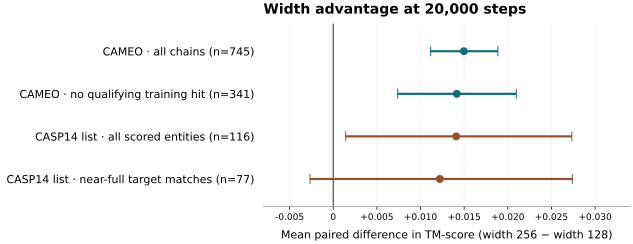

# OPLMFold performance review

17 November 2026 · Fixed-sequence protein structure prediction · [Target-level evidence](targets.csv)

**Keep pair width 256. Correct the training inputs for missing atoms, rebuild the evaluation panels, and spend the first new training budget on better structural supervision.** The strongest immediate inference experiment needs no new weights. Use the existing checkpoint to measure what extra trunk loops, diffusion draws and a better sample selector buy per GPU-second. For complexes, the decisive missing ingredient is training on both partners in a biological assembly. For atomic geometry, first measure whether a refiner improves side chains on a backbone that OPLMFold actually predicted.

The evidence below uses the verified upstream revision `a445037`, the live issue board, the tagged wwPDB index and the two pipeline-proof runs that ended early. The local checkout was 26 commits behind that revision. I treated sequence-only prediction as the default product, and evaluated optional alignments, templates and experimental constraints as additional-input modes. All numerical results are identified as local measurements or results from named external benchmarks. [Repository revision](https://github.com/briney/oplm/tree/a445037708c4ceaf484b11cebddf5cf9aadf01c6) · [Proof runs](https://github.com/briney/oplm/blob/a445037708c4ceaf484b11cebddf5cf9aadf01c6/docs/fold/m2/README.md) · [Prior lab survey](https://github.com/briney/codebox-notebook/blob/88dce7f/projects/oplm/sessions/2026-11-12-08%3A45_survey_post_af3_folding_methods.md)

## What the current head has demonstrated

The proof used frozen ESM-C 600M, a learned mixture of its layers, an encoder that turns these representations into residue-pair features, a recurrent 24-block pair trunk, an all-atom diffusion head and separate confidence outputs. Each trunk block already has outgoing and incoming triangle multiplication and a feed-forward transition. The proof trained on one chain per example, with 384-residue contiguous or spatial crops. The LM saw the full eligible chain. Training already includes LM-input masking, random rigid transformations, sampled loop depth, eight diffusion noise draws per example and EMA. M3 will need a matched run on an OPLM encoder to establish OPLMFold performance with its own LM. [Model](https://github.com/briney/oplm/blob/a445037708c4ceaf484b11cebddf5cf9aadf01c6/src/oplm/fold/modeling_fold.py) · [Pair trunk](https://github.com/briney/oplm/blob/a445037708c4ceaf484b11cebddf5cf9aadf01c6/src/oplm/fold/trunk.py) · [Proof configuration](https://github.com/briney/oplm/blob/a445037708c4ceaf484b11cebddf5cf9aadf01c6/configs/fold/proof-w256.yaml)

| 20,000-step EMA checkpoint | Scored chains | Width 128 TM | Width 256 TM | Width 256 Cα-lDDT | Width 256 all-atom lDDT |
|---|---:|---:|---:|---:|---:|
| CAMEO 2021–22 | 745 | 0.806 | 0.821 | 0.842 | 0.772 |
| Repository CASP14-derived list | 230 | 0.590 | 0.611 | 0.668 | 0.602 |

The length cap excluded seven available CAMEO chains and 18 available CASP-derived entities. All retained predictions succeeded. Each prediction used one sample, seed 0, ten executed trunk loops and 14 nominal diffusion steps. Across the 975 set memberships, the recorded paired TM gain was +0.016, with a 95% bootstrap interval of +0.013 to +0.020. Three chains appear in both lists. Width 256 also beat width 128 at 30,000 steps, an approximately equal training-compute comparison. It cost 5.98 versus 3.78 seconds per training step on 32 B200s. The runs ended at 21,560 and 34,200 steps respectively. Both reached an effective peak LR of 0.000333 because the shared AdamW multiplier was 0.333. For M3, make the multiplier explicit and run a short width-256 LR comparison before changing the optimizer or revisiting width. [Run record and paired comparisons](https://github.com/briney/oplm/blob/a445037708c4ceaf484b11cebddf5cf9aadf01c6/docs/fold/m2/README.md) · [LR issue #119](https://github.com/briney/oplm/issues/119)

## The validation and CASP results change how to select a model

I compared all 64 validation chains and all 975 scored rows with the 126,006 distinct full sequences eligible for proof training. I checked exact sequence equality and searched for alignments of at least 30% identity covering at least 80% of **both** chains. A qualifying match means the experiment can measure prediction with a known structural relative. A search miss can still share a domain, fold or remote homologue. These checks concern the folding-head training corpus. Sequence exposure during LM pretraining is a separate question. [Tagged data](https://huggingface.co/datasets/brineylab/oplmfold-training-data/tree/0fad20d41cbf7f7e1a8ddea0ab098443bbec3172/wwpdb/2026-10-12) · [Per-chain results](targets.csv)

| Cohort | Rows | Exact training sequence | Qualifying training hit | At least 90% identity | Width 256 mean TM with hit / without hit |
|---|---:|---:|---:|---:|---|
| In-training validation | 64 | **27** | **58** | **52** | Only aggregate validation scores were archived |
| CAMEO | 745 | 0 | 404 | 2 | **0.899 / 0.729** |
| CASP14-derived list | 230 | 0 | 75 | 56 | 0.857 / 0.491 |

The validation set contains 56 distinct sequences. Its width-256 live-model TM of 0.918 at 20k describes a short, well-resolved, frequently familiar panel. The splitter removes exact sequence overlaps for the named CAMEO and CASP lists, then chooses the validation entries afterward. Keep this inexpensive monitor for training failures. Use a separate family-controlled development panel for checkpoint selection. On the 341 CAMEO chains without a qualifying training hit, width 256 still improved mean TM by 0.014, with a paired 95% interval of 0.007 to 0.021. This is the best local evidence for retaining the wider head on less familiar chains. [Split logic](https://github.com/briney/oplm/blob/a445037708c4ceaf484b11cebddf5cf9aadf01c6/src/oplm/fold/data/dataset.py#L304-L358) · [Validation curve](https://github.com/briney/oplm/blob/a445037708c4ceaf484b11cebddf5cf9aadf01c6/docs/fold/m2/eval/valid-curves.csv) · [Target-level evidence](targets.csv)

**The 0.611 result describes a mixed PDB-entity cohort.** The acquisition manifest combines officially mapped PDBs, near-full sequence hits and partial matches included to prevent training leakage. The evaluator scores one chain for every distinct protein entity in each listed entry. I joined the scored chains back to the archived RCSB target-to-entity alignments and the raw mmCIF entity identifiers. [Acquisition record](https://github.com/briney/oplm/blob/a445037708c4ceaf484b11cebddf5cf9aadf01c6/docs/fold/m2a/README.md) · [Target loader](https://github.com/briney/oplm/blob/a445037708c4ceaf484b11cebddf5cf9aadf01c6/src/oplm/fold/eval/targets.py#L132-L158) · [Archived target mappings](https://huggingface.co/datasets/brineylab/oplmfold-training-data/tree/0fad20d41cbf7f7e1a8ddea0ab098443bbec3172/wwpdb/2026-10-12/targets)

| Membership of a scored chain | Rows | Width 256 mean TM | Paired TM gain over width 128 |
|---|---:|---:|---:|
| Entity matches a near-full CASP target | 143 | **0.497** | +0.015 |
| Other entity in an entry containing a near-full match | 64 | 0.827 | +0.044 |
| Entry included only for a partial match | 21 | 0.717 | −0.003 |
| Official PDB mapping with unresolved entity assignment | 2 | 0.685 | −0.057 |

The 143 near-full rows represent only 77 exact sequences and 50 CASP target IDs. Giving each sequence equal weight yields width-128/256 means of 0.533/0.545 and a paired difference of +0.012 with a 95% interval of approximately −0.003 to +0.027. These are full-chain diagnostics. Use the organizers’ experimental coordinates, residue correspondences and official evaluation units for a CASP result. CASP14 ran in 2020, before the proof’s September 2021 training cutoff. Use explicit family exclusions for that retrospective panel and a later release window for a prospective one. Retain the original table for historical comparability. [CASP14 target and domain structures](https://predictioncenter.org/download_area/CASP14/targets/) · [Official domain assignments](https://predictioncenter.org/casp14/domains_summary.cgi) · [Target-level evidence](targets.csv)

Each row in the figure gives equal weight to each exact sequence. Intervals resample sequences within the displayed cohort. Cohorts overlap, and related sequences can still belong to the same family.

**Build three panels.** Use a post-cutoff, family-stratified monomer development set, a locked experimental monomer test, and a separate biological-assembly test for complexes. Record target/domain, release date, chain correspondence, resolved coverage, nearest training sequence and structural neighbour, teacher/template cutoff and input mode. Score single-domain and multidomain targets, short/long chains, MSA depth or missing MSA, and monomer versus assembly-dependent chains. Use cluster-level resampling and report skipped, failed and timed-out targets. Include both familiar-family and remote-family performance. The repository’s CASP15/16 and PDB40 contact-evaluation resources are valuable for selecting sequences and evolutionary diagnostics. PDB40 draws from multiple splits. All-atom evaluation requires experimental atom coordinates and a verified held-out manifest. [ProteinNet](https://doi.org/10.1186/s12859-019-2932-0) · [FoldBench](https://pmc.ncbi.nlm.nih.gov/articles/PMC12800276/) · [Foldseek](https://doi.org/10.1038/s41587-023-01773-0) · [Local contact-set builder](https://github.com/briney/oplm/blob/a445037708c4ceaf484b11cebddf5cf9aadf01c6/src/oplm/fold/evalsets/pdb.py)

## Two training and scoring defects found on real structures

1. **The deposited coordinate origin reaches the denoiser through missing atoms.** The parser gives absent atoms zero coordinates. Training subtracts the resolved centroid from every atom, rotates the entire array, adds noise and passes all non-padding atom slots to the denoiser. Translating the resolved coordinates of the repository’s 2DS7 fixture by 100 Å and repeating the identical random augmentation moved the 291 observed augmented inputs by at most 0.000013 Å. All **109 absent atom inputs moved by 100 Å**. The loss masks those atoms, but the denoiser can still attend to them. In the training index, 447,182 of 594,534 eligible chain rows have at least one wholly unobserved residue. Correct the missing-coordinate initialization before augmentation and test translation invariance with gaps. A simple control fills absent positions with the resolved centroid before centering, preserving their normal diffusion noise. Keep experimental observability as a target and compare native-fold scores after a matched retrain. The effect on trained accuracy still needs a matched run. [Parser](https://github.com/briney/oplm/blob/a445037708c4ceaf484b11cebddf5cf9aadf01c6/src/oplm/fold/data/mmcif.py#L179-L199) · [Augmentation](https://github.com/briney/oplm/blob/a445037708c4ceaf484b11cebddf5cf9aadf01c6/src/oplm/fold/diffusion.py#L279-L289) · [Training inputs](https://github.com/briney/oplm/blob/a445037708c4ceaf484b11cebddf5cf9aadf01c6/src/oplm/fold/modeling_fold.py#L501-L545)
2. **Equivalent atom names cost the model accuracy on an identical structure.** On the 1CRN fixture I exchanged eight chemically equivalent atom-name pairs, including coupled aromatic ring flips. Experimental and predicted atoms still occupy the same positions. Named-atom lDDT fell from **1.000 to 0.962**, aligned diffusion MSE rose from zero to **0.092 Ų** per coordinate, and Cα-lDDT stayed at 1.000. Use chemically permitted permutations with a consistent assignment per residue for both training targets and evaluation. Preserve the historical metric as a comparison column and validate the new one against OpenStructure. Handle interchangeable chains separately when complexes enter training. Do this before interpreting small packing or geometry gains. [Current losses](https://github.com/briney/oplm/blob/a445037708c4ceaf484b11cebddf5cf9aadf01c6/src/oplm/fold/losses.py#L103-L138) · [Current scorer](https://github.com/briney/oplm/blob/a445037708c4ceaf484b11cebddf5cf9aadf01c6/src/oplm/fold/eval/monomer.py#L77-L93) · [OpenStructure symmetry settings](https://openstructure.org/docs/2.10/mol/alg/lddt/)

## How to spend inference compute

**Test the existing controls before training a compute policy.** The prediction and evaluation commands expose `--loops`, `--steps`, `--samples` and `--seed`. An OPLM loop reapplies the shared stack to its **pair state**. Diffusion runs after the loop. Multiple diffusion samples in one forward pass share the LM, the random initial pair state and the trunk. A fresh end-to-end seed also changes the initial pair state. Biohub and OPLM use different counting conventions for a loop argument. The upstream release setting of 20 corresponds to 21 executed passes under OPLM’s convention. The diffusion sigma cap also shortens the schedule. Under the proof defaults, 7, 14 and 28 requested steps give **6, 10 and 20 denoiser calls**, respectively. [Inference API](https://github.com/briney/oplm/blob/a445037708c4ceaf484b11cebddf5cf9aadf01c6/src/oplm/fold/predict.py#L89-L139) · [Recurrence](https://github.com/briney/oplm/blob/a445037708c4ceaf484b11cebddf5cf9aadf01c6/src/oplm/fold/trunk.py#L264-L287) · [Capped sampler](https://github.com/briney/oplm/blob/a445037708c4ceaf484b11cebddf5cf9aadf01c6/src/oplm/fold/diffusion.py#L445-L498)

| Question | Bounded comparison on a disjoint development panel | Decision |
|---|---|---|
| Does the trunk still improve the fold? | Width-256 EMA, one draw, fixed schedule. Try 3, 6, 10 and 20 executed loops with matched seeds. Record timing by length. | Keep settings on the accuracy–latency frontier. Deepen the training distribution only if extra loops help or saturate prematurely. |
| Is the uncertainty in the trunk or the final coordinates? | At two competitive loop depths compare one and four diffusion draws from one trunk against independent end-to-end seeds at the same GPU-seconds. Then compare 7/14/28 nominal steps on the retained settings. | If even the native-best draw is poor, change the representation or supervision. A large native-best gain with weak selected gain makes ranking the priority. |
| Which ranker captures the gain? | Save each candidate and score it once. Compare first draw, pTM, mean pLDDT, simple consensus and native-best on the **same** pool. For complexes include ipTM and per-interface scores. | Measure the loss from selecting the wrong draw per target, plus the selected structure’s accuracy. Fit any learned ranker on separate generated candidate pools and validate on new families. |
| Can an easy target exit early? | Compare an always-fixed budget with a rule based on change in the trunk distogram or a small intermediate quality predictor. Learn *marginal gain from more compute* on development targets and log the cost of making the decision. | At equal total GPU time, require improvement on hard targets and retention on easy ones. A confident first pass can still be wrong. |

Report paired TM and symmetry-aware lDDT, DockQ where relevant, geometry, p50/p95 wall time, GPU-seconds, denoiser calls, peak memory and failed targets. Time warm runs and report startup/LM cost separately. Keep per-candidate RNG identifiers and reuse actual coordinates across ranking comparisons. Current evaluation saves only the selected sample’s metrics. At one sample, pTM already tracks difficulty across targets (Spearman 0.851 CAMEO and 0.927 on the CASP-derived list), but those files contain no observations of how pTM orders alternative predictions of the same target. Biohub ranked its monomers by pLDDT. The current OPLM predictor uses pTM. The proof combines its four confidence terms at weight 0.0001, using detached trunk outputs and a 20-nominal-step training rollout. Calibrate pLDDT against its actual atom-to-Cα target as well as measuring its utility for choosing a fold. A confidence-only training stage can then target the failure mode the candidate-pool comparison identifies. [Scoring and aggregation](https://github.com/briney/oplm/blob/a445037708c4ceaf484b11cebddf5cf9aadf01c6/src/oplm/fold/eval/monomer.py#L77-L149) · [Biohub evaluation protocol](https://doi.org/10.64898/2026.06.03.729735) · [CASP16 assessors on model selection](https://doi.org/10.1002/prot.70031)

**Why these experiments have priority.** Boltz-1 held denoising at 200 steps and measured selected whole-complex lDDT of 0.681, 0.702, 0.716 and 0.720 at 0, 1, 3 and 10 recycles. With three recycles it measured 0.693, 0.710 and 0.716 at 20, 50 and 200 steps. Mol-1 obtained about 58.7% DockQ success on its antibody–antigen panel with 30 cycles × 5 seeds, 20 × 10 or 10 × 40, each with five draws per seed. Those are different architectures, targets and budgets. OPLM trains with a clamped Poisson depth of 1–6, mean parameter 3, and gradients through the last two loops, then already evaluates at ten. Test a deeper late training distribution at matched GPU-hours and a fixed crop before coupling it to a crop curriculum. The Mol-1 report describes a beta curriculum while the released forward path inspected for #100 samples uniformly. [Boltz-1, Table 1](https://pmc.ncbi.nlm.nih.gov/articles/PMC11601547/) · [Mol-1 report](https://github.com/molence/Mol-1/blob/main/assets/report.pdf) · [OPLM recurrence defaults](https://github.com/briney/oplm/blob/a445037708c4ceaf484b11cebddf5cf9aadf01c6/src/oplm/fold/configuration_fold.py#L70-L99) · [Issue #100](https://github.com/briney/oplm/issues/100)

## Where the next training run can gain accuracy

**1. Change the mix of structures the head sees.** Today one eligible PDB entry supplies one randomly chosen chain per pass. The 175,065 eligible deposits contain 126,006 distinct eligible sequences. One exact sequence occurs in 562 eligible entries. Compare the current sampler with cluster-then-member sampling at fixed updates and crop budget. Preserve different experimental conformations within a cluster. Then compare experimental-only training with a versioned mixture of experimental structures and confidence-filtered teacher predictions. Use the same encoder, LR, target families, sequence-length distribution and total training budget. Record how many distinct families, coordinates and residue pairs each arm actually saw. [Dataset sampling](https://github.com/briney/oplm/blob/a445037708c4ceaf484b11cebddf5cf9aadf01c6/src/oplm/fold/data/dataset.py#L546-L556) · [Published snapshot](https://huggingface.co/datasets/brineylab/oplmfold-training-data/tree/0fad20d41cbf7f7e1a8ddea0ab098443bbec3172/wwpdb/2026-10-12)

The most relevant controlled precedent is SimpleFold-700M. The authors report mean CASP14 TM of **0.606 with PDB only, 0.649 after two rounds of self-distillation and 0.680 with external AFDB/AFESM labels**. The corresponding CAMEO22 scores were 0.785, 0.805 and 0.829. Upstream ESMFold2 mixed experimental PDB and filtered AFDB with probabilities 0.3 and 0.7. Those training runs used different LMs, target sets and compute from ours. Their results justify a local data experiment before a trunk replacement. A contained pilot can use OpenProteinSet’s 270,262 distilled structures. The larger OpenFold3 collections are appropriate once the smaller test establishes value. OpenProteinSet is biased toward alignable sequences and used a December 2021 template set, which matters for early CAMEO targets. Track the teacher, database and template dates for every source. [SimpleFold data ablation](https://arxiv.org/html/2509.18480) · [ESMFold2 training data](https://doi.org/10.64898/2026.06.03.729735) · [OpenProteinSet](https://proceedings.neurips.cc/paper_files/paper/2023/file/0eb82171240776fe19da498bef3b1abe-Paper-Datasets_and_Benchmarks.pdf) · [OpenFold3 data registry](https://registry.opendata.aws/openfold3/)

Two implementation details determine whether that experiment is interpretable.

- Give teacher coordinates a separate reliability mask or weight. The current model uses `resolved` for coordinate losses **and** the classifier that predicts experimental observability. Teacher pLDDT stored in a B-factor column currently supplies neither weighting nor an experimental label. Train observability and calibrate confidence on experimental structures. Track relative-domain PAE and interface confidence separately when using complex teachers. For experimental data, mask zero-occupancy sites. In the real training deposit 1FIW, five lysine side-chain atoms at chain A position 53 have zero occupancy and the current parser treats their presence as resolved. Keep resolution, occupancy, method and alternate conformers so local-geometry training can use the higher-quality labels. PDB-REDO provides an experimental re-refinement comparison for X-ray structures. [Training losses](https://github.com/briney/oplm/blob/a445037708c4ceaf484b11cebddf5cf9aadf01c6/src/oplm/fold/modeling_fold.py#L490-L609) · [1FIW coordinates](https://www.rcsb.org/structure/1FIW) · [wwPDB procedures](https://www.wwpdb.org/documentation/procedure) · [PDB-REDO data](https://pdb-redo.eu/download)
- Vary the chain, crop and reference-conformer augmentation when a smaller source refills. The fold trainer currently uses the default replay order. The structure reader keys its choices to the outer epoch and row, independent of the within-epoch source pass. With millions of teacher examples, an oversampled experimental deposit can recur many times with exactly the same crop. Add the refill pass to deterministic sampling and verify resumed draws reproduce the same suffix. This matters specifically for mixed-source runs. [Fold dataloader](https://github.com/briney/oplm/blob/a445037708c4ceaf484b11cebddf5cf9aadf01c6/src/oplm/fold/training.py#L189-L210) · [Source refill behavior](https://github.com/briney/oplm/blob/a445037708c4ceaf484b11cebddf5cf9aadf01c6/src/oplm/data/sequence/dataset.py#L747-L763) · [Structure reader](https://github.com/briney/oplm/blob/a445037708c4ceaf484b11cebddf5cf9aadf01c6/src/oplm/fold/data/dataset.py#L631-L669)

**2. Train on the relationships the output is supposed to predict.** Multi-chain input and ipTM already work at inference. The proof parsed the crystallographic asymmetric unit and cropped a single chain for training. For M3, expand deposited biological-assembly operators, retain chain identities and stoichiometry, deduplicate equivalent interfaces, crop across actual contacts, and handle interchangeable chains and side-chain symmetries in the labels. Start with experimental protein assemblies and a monomer-retention arm. Evaluate per-interface DockQ, interface lDDT, and separate homomer and heteromer outcomes at the same selection budget. Coupling correctly folded monomers into an incorrect assembly can leave global lDDT deceptively high. [M3 #49](https://github.com/briney/oplm/issues/49) · [Current crops](https://github.com/briney/oplm/blob/a445037708c4ceaf484b11cebddf5cf9aadf01c6/src/oplm/fold/data/crop.py) · [RCSB biological assemblies](https://pdb101.rcsb.org/learn/guide-to-understanding-pdb-data/biological-assemblies) · [DockQ v2](https://doi.org/10.1093/bioinformatics/btae586)

Use the public AFDB complex sets as a second arm. EMBL-EBI reported 1.7 million high-confidence homodimers and nearly 80,000 high-confidence heterodimers in the cited release. A naive pooled sampler would teach a strong homomer prior. Sample by interface clusters and source, screen the interface itself, and retain held-out experimental heteromers. Test Teddymer separately because splitting interacting domains of one chain supplies a different negative space and orientation distribution from pairs of independent chains. Treat disorder-enriched examples as a distinct source with their own evaluation. AF3’s disorder-distillation ablation, for example, improved a surface-accessibility-based disorder AUROC from 0.67 to 0.95 on low-homology CAID2 proteins. That is evidence for measuring hallucinated compact structure in unresolved regions. [AFDB complex release](https://www.ebi.ac.uk/about/news/technology-and-innovation/first-complexes-alphafold-database/) · [Teddymer origin](https://openreview.net/pdf/d0d1b6e1faa5cedf2608f66712167ccf67e079da.pdf) · [AlphaFold 3](https://doi.org/10.1038/s41586-024-07487-w)

**3. Test a longer structural context at fixed compute.** The head trains on 384 tokens and the proof excludes whole chains longer than 1,024. In the CASP14-derived list the 86 rows longer than 384 averaged 0.443 TM, against 0.711 for the 144 shorter rows. CAMEO showed 0.829 and 0.818 for the corresponding length groups. Cohort and homology matter. Try a late 384→640 or 768 crop stage against continued 384 training. Keep source mix and loop schedule fixed, measure both per-domain accuracy and relative domain placement, and account for the reduction in independent examples per GPU-hour. Add interface-centered crops in the complex arm. [Target rows](targets.csv) · [Training config](https://github.com/briney/oplm/blob/a445037708c4ceaf484b11cebddf5cf9aadf01c6/configs/fold/proof-w256.yaml) · [Boltz-2](https://pmc.ncbi.nlm.nih.gov/articles/PMC12262699/)

Profile **training** memory before a long-crop campaign. The smooth-lDDT loss constructs dense resolved-atom pairs for every noise draw after the denoiser microbatch loop. A CPU autograd storage probe measured about 37 bytes per ordered atom pair per draw. At 2,048 residues averaging eight observed heavy atoms, eight draws project to about **74 GiB for that loss alone** at batch one. An exact reference-neighbour list at the 15 Å cutoff can be reused across rotations and noise draws. A chunked backward pass is another option. Compare loss, gradients and B200 peak memory before adopting either. On inference, the existing random-head, LM-excluded B200 sweep already reached 4,096 tokens at width 256 with one draw, or 3,072 with five. Remaining kernel work and Fold-CP address a different limit. [Loss implementation](https://github.com/briney/oplm/blob/a445037708c4ceaf484b11cebddf5cf9aadf01c6/src/oplm/fold/losses.py#L115-L138) · [Measured inference limits](https://github.com/briney/oplm/blob/a445037708c4ceaf484b11cebddf5cf9aadf01c6/docs/FOLD.md#12-inference-memory-and-maximum-length)

**4. Isolate the encoder and the information reaching the head.** Compare frozen ESM-C 600M, the chosen frozen OPLM checkpoint with a newly matched projection, and a head trained without LM features. Hold width, label source and head-training budget fixed. For an external control use Biohub’s experimental Fast head with its own matching 600M LM, then production ESMFold2-Fast with its 6B LM. Check which experimental heads supply confidence before ranking them. Test late-block adapters or training-only pair/distogram distillation only if the frozen OPLM arm shows a reproducible gap. The existing categorical-Jacobian and contact panels can localize a deficit in long-range pair information. Reusing test-set couplings as training labels would invalidate that diagnosis. [Local layer mixture](https://github.com/briney/oplm/blob/a445037708c4ceaf484b11cebddf5cf9aadf01c6/src/oplm/fold/lm_shim.py#L39-L73) · [Matched Biohub 600M head](https://huggingface.co/biohub/ESMFold2-Experimental-Fast-base600M-step1500k) · [Confidence-disabled experimental configuration](https://huggingface.co/biohub/ESMFold2-Experimental-Fast-base600M-step750k/blob/main/config.json) · [Structural reference scores #84](https://github.com/briney/oplm/issues/84)

An optional alignment-assisted prediction or an MSA-informed teacher is worth pricing. Full ESMFold2 reports FoldBench monomer lDDT **0.84 sequence-only and 0.89 with MSA input**. Its frozen-LM scaling experiment also found improvements when holding the folding-head recipe fixed. This makes extra evolutionary information a more credible lever than indiscriminate depth. Report ordinary single-sequence inference, training-only teacher supervision, and inference with retrieved alignments or templates as three distinct comparisons. Charge retrieval latency and date-filter the databases for the third track. [ESMFold2, Fig. 2 and supplementary Fig. S6](https://doi.org/10.64898/2026.06.03.729735) · [Chai-1 report](https://chaiassets.com/chai-1/paper/technical_report_v1.pdf)

## What RFD4-Proteina contributes to atomic geometry

**Keep the sequence and backbone fixed for the first test.** The authors’ decoder uses a residue anchor and a 32-dimensional latent with cross-residue attention. In their controlled decoder fine-tuning comparison, adding energy supervision reduced mean Rosetta energy by **1.07 kcal/mol per residue** and bond-angle deviations over 5° by **62%**. On **114 native CASP14/15 backbones**, their side-chain packing gave mean MolProbity **1.70 versus 1.99** for LigandMPNN at similar diversity. Those endpoints establish improved chemical plausibility in those settings. An independent benchmark found routine repacking of AF2/AF3-predicted backbones often worsened side-chain accuracy, even for packers that perform well on native backbones. This is the reason to run the lowest-cost part of #133 before investing in a latent decoder. [RFD4-Proteina manuscript, sections S6.1 and S10.1](https://github.com/RosettaCommons/RFD4-Proteina/blob/191c5e4af0402364cf001a05903d466befd99273/website/assets/paper/RFD4-Proteina.pdf) · [Predicted-backbone packing benchmark](https://doi.org/10.1093/bib/bbaf297) · [Geometry issue #133](https://github.com/briney/oplm/issues/133)

| Stage | Comparison | Evidence that justifies continuing |
|---|---|---|
| External refinement, no head training | Same predicted structures and sequence throughout. Compare untouched output, conventional restrained repacking/relaxation and RFD4 fixed-sequence packing. Add a specialist such as PIPPack if budget permits. Run the same controls on native backbones and verify every constrained backbone atom and residue identity. | Improved clashes, rotamers, bond/angle and chirality outliers with preserved or improved experimental side-chain accuracy. Report symmetry-aware side-chain RMSD, χ recovery and interface lDDT on predicted and native backbones separately. |
| Current all-atom head | After symmetry and occupancy corrections, compare unchanged training against modest local geometry supervision on predicted clean coordinates, and against a late high-quality-data fine-tune. Separate the effects of target cleanup, added loss and relaxation. | Gains in experimental coordinates and chemical validity at matched sampling cost. Monitor backbone TM, interface DockQ, rare conformers and runtime. |
| Anchor-plus-latent prototype | Test the specific released autoencoder and sequence conditioning. Measure a native encode/decode round trip by residue type and at interfaces. Measure decoder cost. | Advance only if the simpler arms leave a reproducible gap, reconstruction preserves the distinctions being scored, and the new head has a plausible accuracy or throughput advantage. |

Choose the candidate with a score available at inference. Reserve native-best results for diagnosis. Report raw and refined coordinates separately, particularly if a relaxation is allowed to move the backbone. The released decoder’s energy-tuned checkpoint/recipe needs verification before attributing a local outcome to the paper’s energy objective. PIPPack supplies a control with idealized residue geometry. SimpleFold showed that toggling a smooth-lDDT term during fine-tuning shifted all-atom lDDT from 0.711 to 0.767 at the same 0.831 mean TM. Biohub disabled smooth lDDT in its own second training stage. Use both native coordinate and geometry endpoints when choosing a stage or weight. [PIPPack](https://pmc.ncbi.nlm.nih.gov/articles/PMC11511640/) · [SimpleFold, loss ablation](https://arxiv.org/html/2509.18480) · [Biohub training stages](https://doi.org/10.64898/2026.06.03.729735)

## Which architectural alternatives deserve a trial

I searched primary papers, technical reports, author repositories and model/data releases through 17 November 2026. The search covered single-sequence folders, alignment and template methods, all-atom co-folders, lightweight and few-step models, conformational ensembles, structural representation transfer, packers, quality estimators and design-model decoders. The table groups additional results by the experiment they change. Target cohorts, training cutoffs, input information, hardware and ranking rules differ across papers. A near-tie to a published leaderboard score is weak evidence for changing this head.

| Tools and primary evidence | What transfers to OPLMFold |
|---|---|
| **ESMFold v1, ESMFold2/Fast, ESM3, xT-Fold.** A matched eight-block ESMFold v1 ablation scored 0.74 CAMEO all-atom lDDT, 0.58 without LM features and 0.66 without the trunk. ESMFold2 measured improved monomer accuracy across frozen encoder checkpoints with the same head recipe. ESM3 investigated iterative structural decoding. xT-Fold reported 0.70 CASP15 TM with its 100B encoder against 0.65 for ESMFold on its 56-target panel. [ESMFold](https://doi.org/10.1126/science.ade2574) · [ESMFold2](https://doi.org/10.64898/2026.06.03.729735) · [ESM3](https://doi.org/10.1126/science.ads0018) · [xT-Fold](https://doi.org/10.1038/s41592-025-02636-z) | Start with matched frozen encoders. Compare size and pretraining progress separately where checkpoints allow. An expensive released model is useful as an upper comparison even when it is impractical as a deployment choice. |
| **OmegaFold, HelixFold-Single, RGN2, RaptorX-Single.** These explore learned pair geometry, a PLM feeding an AF2-like stack, backbone frames, and combining multiple PLMs. HelixFold-Single’s results vary with family depth, and RaptorX-Single reported orphan-set TM 0.43 against 0.42 for ESMFold. [OmegaFold](https://doi.org/10.1101/2022.07.21.500999) · [HelixFold-Single](https://doi.org/10.1038/s42256-023-00721-6) · [RGN2](https://doi.org/10.1038/s41587-022-01432-w) · [RaptorX-Single](https://doi.org/10.1073/pnas.2308788121) | Evaluate remote-family and secondary-structure strata. A backbone-only method supplies a Cα comparison. An encoder ensemble must earn its full inference cost. |
| **MiniFold, SimpleFold, AtlasFold/M, TDFold.** MiniFold reports CASP15 TM 0.657 at 1.31 s/sequence versus ESMFold v1 at 0.659 and 10.48 s on 47 targets. SimpleFold provides a pair-free transformer/flow baseline trained at large data scale. AtlasFold publishes a trainable sequence-conditioned monomer-to-complex path. TDFold generated pair distances and orientations and reported gains on small orphan panels. [MiniFold](https://openreview.net/pdf/89d3b3a1986b81043b3eb11c5625089c05e529ec.pdf) · [SimpleFold](https://machinelearning.apple.com/research/simplefold) · [AtlasFold](https://github.com/SeonghwanSeo/atlasfold) · [TDFold](https://doi.org/10.1038/s42256-026-01210-2) | Try distogram-only warmup or an orientation auxiliary if a frozen-head probe locates the error in the pair representation. Compare per-domain TM, full-chain TM and all-atom lDDT. A pair-free decoder is a credible longer-term latency comparison. The proof trunk already incorporates several simplifications relative to ESMFold v1. |
| **AlphaFold2, OpenFold, RoseTTAFold and AlphaFold3.** Explicit MSA and pair representations, a recurrent structure track, self-distillation, and eventually atom diffusion address different sources of signal. OpenFold supplies a trainable AF2 reference. [AlphaFold2](https://doi.org/10.1038/s41586-021-03819-2) · [OpenFold](https://pmc.ncbi.nlm.nih.gov/articles/PMC11645889/) · [RoseTTAFold](https://doi.org/10.1126/science.abj8754) · [AlphaFold3](https://doi.org/10.1038/s41586-024-07487-w) | Use aligned versus stripped-input controls on identical targets. If per-domain folds are correct but relative placement repeatedly fails, test feeding predicted coarse geometry back between pair updates against additional ordinary loops at equal runtime. This is a larger intervention than changing loop count. |
| **Chai-1, Boltz-1/2, Protenix v1/v2, OpenFold3 and RoseTTAFold3.** Public methods span PLM/MSA integration, sparse conditioning, experimental-method conditioning, disorder supervision, and implicit chirality. OpenFold3 publishes teacher data. Protenix model releases have version-specific weight terms. [Chai-1](https://github.com/chaidiscovery/chai-lab) · [Boltz-2](https://pmc.ncbi.nlm.nih.gov/articles/PMC12262699/) · [Protenix](https://github.com/bytedance/Protenix) · [OpenFold3](https://portal.openfold.io/reports/of3p2_technical_report.pdf) · [RF3](https://github.com/RosettaCommons/foundry/blob/production/models/rf3/README.md) | Run at least one released AF3-family comparator on the exact same assembly panel with declared input information. Method-conditioned or disorder-rich labels warrant an endpoint for the associated state. Restrict teacher ingestion to versions whose provenance and data terms fit the project. |
| **SeedFold, Protenix-Mini/Mini+ and lightweight samplers.** At the same measured training iterations/s, SeedFold found widening pair/MSA channels more effective than doubling trunk or denoiser depth. Both widths changed. Protenix-Mini+ gained only 0.004 median within-protein lDDT going from 4 to 10 cycles at two denoiser steps on RecentPDB mixed complexes. Few-step results depended on the numerical sampler and could worsen steric clashes. [SeedFold](https://arxiv.org/html/2512.24354) · [Protenix-Mini](https://arxiv.org/html/2507.11839) · [Mini+](https://arxiv.org/html/2510.12842) | Retain selected full pair interactions. Compare occasional narrower or cheaper pair blocks only if the runtime breakdown shows trunk cost dominates. Evaluate changing the solver separately from reducing step count. Measure the fraction of whole-prediction time actually saved. |
| **ColabFold, AFsample, CycleCritic, DeCAF and Blitz.** These cover convergence-based early exit, massive candidate generation, predicting confidence from an early trunk state, and few-step sampler distillation. [ColabFold](https://doi.org/10.1038/s41592-022-01488-1) · [AFsample](https://doi.org/10.1093/bioinformatics/btad573) · [CycleCritic](https://arxiv.org/abs/2610.40665) · [DeCAF](https://github.com/genesistherapeutics/decaf) · [Blitz](https://arxiv.org/abs/2610.23703) | Compare early exit against a fixed-time policy using experimental accuracy. Move to sampler distillation only if a strong teacher and an expensive denoising phase justify it. In the proof, only ten denoiser calls already execute at the default. Profile the head end to end to estimate how much time a faster sampler could recover. |
| **OpenDDE, Mol-1, TorchFold and NovaAtom-Lite.** OpenDDE reports a sizable gap between selected and oracle-best complex predictions at high sample counts. TorchFold’s antibody–antigen success rose from 34.0% to 65.9% to 70.1% across stages that changed both data and training settings. NovaAtom-Lite’s published comparison uses different denominators for several leaderboard entries. [OpenDDE](https://arxiv.org/html/2607.03787v1) · [Mol-1](https://github.com/molence/Mol-1) · [TorchFold](https://torchx-cpl.github.io/assets/papers/torchfold.pdf) · [NovaAtom-Lite](https://www.geodesiclab.com/news/introducing-novaatom-lite) | Try a confidence-only stage on frozen candidate pools, then test interface data and crop size independently. OpenDDE’s backbone/side-chain structural tokens offer a middle-cost local refiner if direct geometry fine-tuning fails. Treat published bundled gains as motivation for isolated ablations. |
| **SoupFold and K-Fold.** SoupFold learns mappings between other models’ pair spaces. K-Fold uses available monomer conformations to condition assembly prediction. [SoupFold](https://arxiv.org/abs/2609.15552) · [K-Fold](https://github.com/kaist-ai-bio/kfold) | Try training-only pair transfer against a coordinate/distogram-only teacher if conventional distillation plateaus. For two independently folded partners, compare no input pose to independently predicted apo structures. A reference-derived subunit or contact map needs its own oracle label. |
| **IgFold, ImmuneBuilder and ABodyBuilder3.** These model antibody domains, including difficult CDR loops. [IgFold](https://doi.org/10.1038/s41467-023-38063-x) · [ImmuneBuilder](https://doi.org/10.1038/s42003-023-04927-7) · [ABodyBuilder3](https://arxiv.org/abs/2405.20863) | Score isolated domain/CDR accuracy and partner placement separately in M4. Otherwise an improved antibody template can be mistaken for improved docking. Group related antibodies and antigens when holding out interfaces. |
| **AlphaFlow/ESMFlow, BioEmu2, RFdiffusion, RFdiffusion3, BoltzGen and La-Proteina.** These inform ensemble evaluation, alternative coordinate parameterizations and decoder constraints. La-Proteina’s native-structure autoencoding reached about 0.12 Å mean all-atom reconstruction RMSD. In one benchmark with repeated native structures, AlphaFlow increased diversity while median native-state recall declined from 0.823 to 0.801 versus AF2. [AlphaFlow](https://proceedings.mlr.press/v235/jing24a.html) · [BioEmu2](https://github.com/microsoft/bioemu2) · [RFdiffusion](https://doi.org/10.1038/s41586-023-06415-8) · [Foundry](https://github.com/RosettaCommons/foundry) · [BoltzGen](https://github.com/HannesStark/boltzgen) · [La-Proteina](https://arxiv.org/html/2507.09466) | Test ensemble coverage and precision against multiple independently observed conformations when predicting states. For a fixed sequence with a single known structure, use experimentally scored top-1 and oracle-at-budget. Design/refolding success and native encode/decode fidelity answer different questions about the model. |

NeuralPLexer3 supplies an alternative flow-based assembly predictor, IntFold a controllable predictor, and HelixFold3 another AF3-family implementation. A recent fixed-weight projection study tested a cheaper geometric intervention on Boltz-2 and OpenFold3. It corrected inter-chain overlaps and separately enforced ligand geometry. If the local failure audit finds clashes, compare the inter-chain correction with restrained relaxation and measure the resulting experimental interface accuracy. The November 16 Calpha preprint also tested a general-purpose language model with a folding head. Its 300–600-residue results trailed its direct ESM2-to-SimpleFold baseline on three panels, which gives little reason to prioritize that architectural change here. [NeuralPLexer3](https://arxiv.org/abs/2412.10743) · [IntFold](https://arxiv.org/abs/2507.02025) · [HelixFold3](https://github.com/PaddlePaddle/PaddleHelix/tree/dev/apps/protein_folding/helixfold3) · [Inference-time projection](https://arxiv.org/abs/2610.07037) · [Calpha](https://arxiv.org/abs/2611.20986)

## Issue-board decisions and experiment order

| Board work | Recommended disposition |
|---|---|
| [#48 width proof](https://github.com/briney/oplm/issues/48), [#119 effective LR](https://github.com/briney/oplm/issues/119) | #48 is done. Use the run evidence in `docs/fold/m2`. The methods summary still labels width selection pending. Pin the optimizer multiplier and compare effective 0.000333 versus 0.001 at width 256 before a long M3 run. |
| [#49 M3](https://github.com/briney/oplm/issues/49), [#50 M4](https://github.com/briney/oplm/issues/50) | Make correct labels, split manifests and a baseline on the first selected OPLM encoder explicit M3 deliverables. Establish the assembly benchmark and an experimental-only complex arm before antibody specialization. Track the effect on ordinary monomers throughout. |
| [#90 ranking](https://github.com/briney/oplm/issues/90), [#100 loop curriculum](https://github.com/briney/oplm/issues/100) | Start the **evaluation** parts on the existing EMA weights. Decide on confidence-only training from the observed selection gap and on a depth curriculum from the measured loop–cost curve. |
| [#133 atomic geometry](https://github.com/briney/oplm/issues/133), [#91 interface shape loss](https://github.com/briney/oplm/issues/91) | Preserve #133’s proposed order. Fix the symmetric-atom scorer first. #91 depends on real interface crops. Compare it with a simple clash/bond baseline, judge both native accuracy and physical validity, and keep its training weight separate. |
| [#92 SAbDab ramp](https://github.com/briney/oplm/issues/92), [#93 distillation](https://github.com/briney/oplm/issues/93) | Compare an early ramp against late-only exposure with equal cumulative antibody examples. Add real complexes, pseudo-dimers and disorder/motif sources one at a time. Check family/partner overlap, source terms, class balance and general-fold retention. |
| [#94 external constraints](https://github.com/briney/oplm/issues/94) | Evaluate as an optional assisted-input mode after an unassisted complex baseline exists. Compare no hints, independently available hints, shuffled hints and reference-derived oracle hints. A solved-contact hint changes the task and deserves its own result column. |
| [#101 pair chunking](https://github.com/briney/oplm/issues/101), [#105 Fold-CP](https://github.com/briney/oplm/issues/105) | The remaining fused triangle-multiplication transient trades speed for memory. Trigger further work from an actual target-length, sample-count and hardware requirement. Credit the completed per-sample confidence, allocator, tensor-lifetime and attention fixes. [#102](https://github.com/briney/oplm/issues/102) · [#103](https://github.com/briney/oplm/issues/103) · [#104](https://github.com/briney/oplm/issues/104) · [#107](https://github.com/briney/oplm/issues/107) · [#108](https://github.com/briney/oplm/issues/108) |
| [#80 coevolution](https://github.com/briney/oplm/issues/80), [#84 reference scores](https://github.com/briney/oplm/issues/84), [#131 diversity sampling](https://github.com/briney/oplm/issues/131) | Use evolutionary diagnostics to explain where the encoder helps. Add complete fixed-sequence structure baselines to the head study. #131 is an LM-data ablation and inspires a distinct structure-sampler experiment. Keep LM loop-depth studies [#98](https://github.com/briney/oplm/issues/98) and [#99](https://github.com/briney/oplm/issues/99) separate from the folding-trunk compute budget. |

**Order of spend.** First, repair the benchmark and record the missing-atom and symmetry regression cases. In parallel, use existing weights for the compute/ranking comparison and the predicted-backbone packing comparison. Next, hold the width-256 architecture fixed while establishing the OPLM encoder baseline and settling the effective LR. Spend the first substantial additional training budget on confidence-aware monomer distillation and real assembly crops, using separate arms. A larger trunk, a new solver, a latent decoder and Fold-CP each need a measured bottleneck or residual error that its cheaper control failed to close.

For an accuracy change, preregister one primary endpoint and one compute budget per task. A practical starting point for monomers is the project’s own 0.01 paired TM improvement criterion, with symmetry-aware lDDT and hard-family results alongside it. For complexes, use the change in top-ranked DockQ success at a fixed sample budget and report continuous DockQ. For a geometry or speed change, preregister allowable loss in experimental accuracy and the required improvement in the intended endpoint. Bootstrap held-out target families or interface clusters, keep every failure in the denominator, and lock the test set before tuning the rule.

## Audit details

- **Training comparison.** Both 20k EMA CSVs came from upstream commit `a445037708c4ceaf484b11cebddf5cf9aadf01c6`. Join on target set, PDB ID and label chain ID. All 975 paired rows had status `ok`. The in-training validation curve uses live weights. Each proof run used one training seed. Target bootstrap intervals describe variability across targets at these checkpoints. Training-seed variability remains unmeasured. [Width 128 rows](https://github.com/briney/oplm/blob/a445037708c4ceaf484b11cebddf5cf9aadf01c6/docs/fold/m2/eval/proof-w128/step-20000/targets.csv) · [Width 256 rows](https://github.com/briney/oplm/blob/a445037708c4ceaf484b11cebddf5cf9aadf01c6/docs/fold/m2/eval/proof-w256/step-20000/targets.csv)
- **Sequence search.** The local wwPDB manifest matched the committed October snapshot byte for byte. The index SHA-256 was `ab50517fa3ce859e6eb3a6e31a0e3b8a9819d74f1a750f7ab40e41e8fb59af54`. Restrict to training chains up to 1,024 residues with at least four observed residues, deduplicate exact sequences, and search the 914 distinct query sequences from the three panels. MMseqs2 version 18.8cc5c used sensitivity 7.5, E-value 0.001, minimum sequence identity 0.30, coverage 0.80, coverage mode 0, alignment mode 3 and at most 300 prefilter candidates. The CSV contains the highest-identity returned alignment, with bit score breaking identity ties and a representative training entry/chain. Identity is a percentage, coverage a fraction. Blank alignment fields mean no qualifying returned hit. Full-sequence equality is computed independently. Domain homology, structural similarity and encoder pretraining overlap require separate checks. [MMseqs2 definitions](https://github.com/soedinglab/MMseqs2/wiki) · [Tagged index](https://huggingface.co/datasets/brineylab/oplmfold-training-data/blob/0fad20d41cbf7f7e1a8ddea0ab098443bbec3172/wwpdb/2026-10-12/index.parquet)
- **CASP membership.** For each official query, retain shipped RCSB alignments with reported identity ≥0.95 and inclusive query alignment span ≥80% of target length. Join the hit’s original PDB entity identifier to the scored label chain using the deposited mmCIF `_struct_asym` table. Partial-only entries are those absent from the union of official and near-full entry lists. The two official-only rows are both from 6N64. Equal-sequence estimates average the matched width differences for each exact parsed sequence first. The figure uses 10,000 paired percentile bootstrap resamples with NumPy seed 0. [Source mappings](https://huggingface.co/datasets/brineylab/oplmfold-training-data/tree/0fad20d41cbf7f7e1a8ddea0ab098443bbec3172/wwpdb/2026-10-12/targets/sources)
- **Evidence file.** Each of the 1,039 rows includes its set, identifiers, length, an exact-sequence group ID (first 24 hexadecimal characters of SHA-256), training similarity and applicable CASP membership. The 975 offline rows carry both widths’ TM and width-256 confidence and lDDT. Validation score cells are blank because only aggregates were archived. The grouped analyses, figure and real-fixture checks used CPU. Accuracy gains from retraining, sample selection, geometry refinement and longer inference remain prospective. [Target-level evidence](targets.csv)
